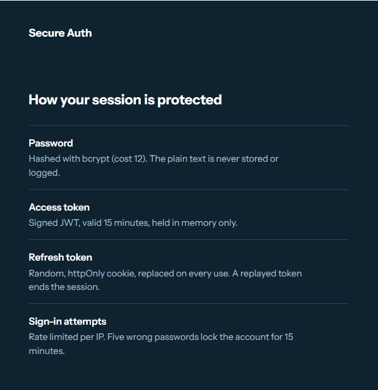
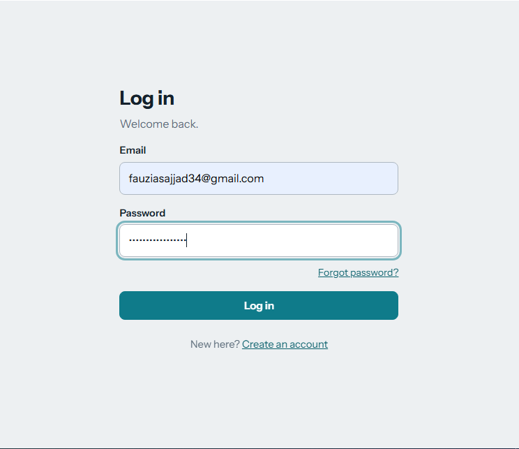
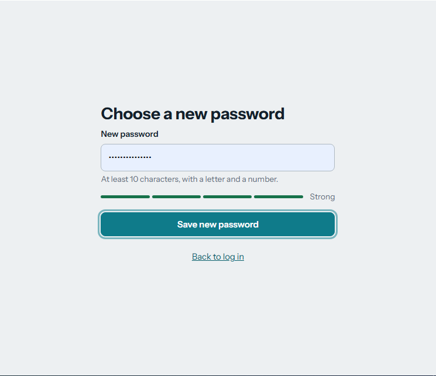
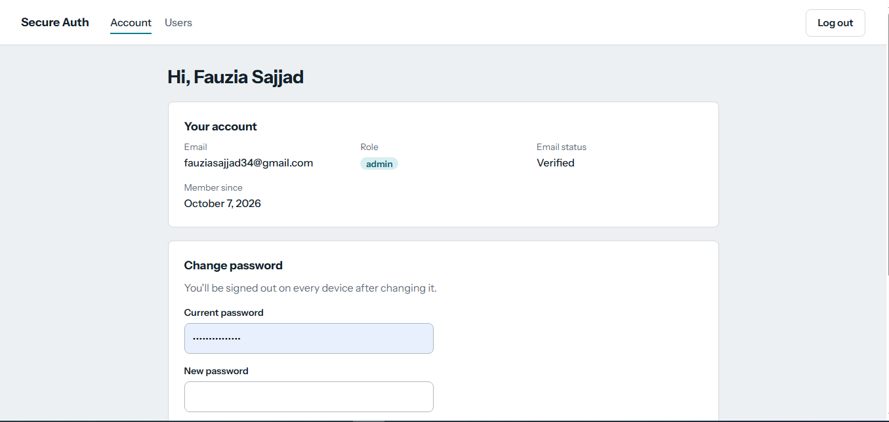
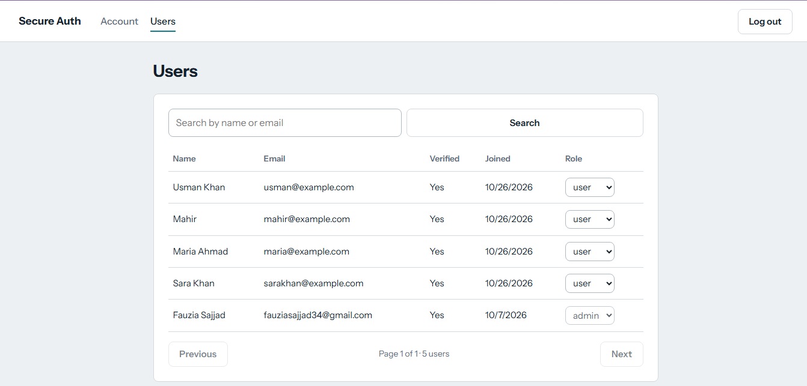
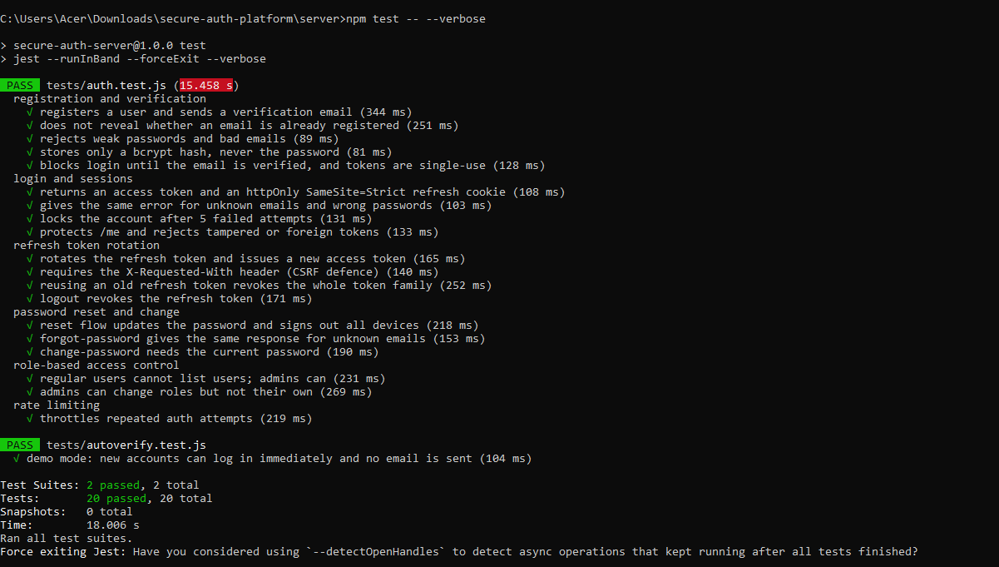

# Secure Authentication Platform

Live demo:https://secure-auth-platform.vercel.app/

A full-stack authentication system built with React, Express, and PostgreSQL. It covers the flows real apps need (verification, reset, sessions, roles) and defends against common OWASP Top 10 risks.



| Sign in | Reset password |
| --- | --- |
|  |  |

| Dashboard | Admin panel |
| --- | --- |
|  |  |

### Tests



## Features

- Registration with email verification (single-use, 24 hour links)
- Login with short-lived JWT access tokens (15 min) and rotating refresh tokens (7 days)
- Refresh token reuse detection: replaying a used token revokes the whole session family
- Password reset by email (30 min, single-use) that signs out every device
- Change password, sign out of all devices
- Role-based access control (`user` / `admin`) with an admin panel (search, pagination, role changes)
- Account lockout after 5 failed logins, plus IP rate limiting
- Audit log of security events (login, lockout, reset, token reuse)
- 20 integration tests (Jest + Supertest)

## Security decisions

| Risk | Defence |
| --- | --- |
| Password theft from DB | bcrypt (cost 12), 72 char max so nothing is silently truncated |
| SQL injection | Parameterized queries only (`pg`) |
| XSS token theft | Access token kept in memory; refresh token is an `httpOnly` cookie |
| CSRF | `SameSite=Strict` cookie, plus a required `X-Requested-With` header on cookie endpoints |
| Brute force | Per-IP rate limit on auth routes and 15 minute account lockout |
| Account enumeration | Same response for register, forgot-password, and unknown-email login (with equalized timing) |
| Token database leak | Refresh and email tokens are stored as SHA-256 hashes |
| Stolen refresh token | Rotation on every use, family revocation on reuse |
| Bad input | `zod` validation, 10 KB body limit |
| Header-based attacks | `helmet` security headers, `x-powered-by` disabled |

Known tradeoffs: role changes take effect when the access token is next issued (up to 15 minutes), and two browser tabs refreshing at the exact same instant can trigger the reuse check. The client shares one in-flight refresh per tab to reduce this.

## Run it locally

Requirements: Node 18+, Docker (or your own PostgreSQL).

```bash
# 1. Database (creates `authdb` and `authdb_test`)
docker compose up -d

# 2. API
cd server
cp .env.example .env        # then set JWT_ACCESS_SECRET (see the comment inside)
npm install
npm run dev                 # runs the migration automatically, listens on :4000

# 3. Client (new terminal)
cd client
npm install
npm run dev                 # http://localhost:5173
```

With no SMTP settings, verification and reset emails are printed in the API terminal. Register with the email you set as `ADMIN_EMAIL` to get an admin account.

### Tests

```bash
cd server
npm test
```

## API

| Method | Path | Auth | Purpose |
| --- | --- | --- | --- |
| POST | `/api/auth/register` | none | Create account, send verification email |
| POST | `/api/auth/verify-email` | none | Confirm email with token |
| POST | `/api/auth/resend-verification` | none | Send a new verification link |
| POST | `/api/auth/login` | none | Returns access token, sets refresh cookie |
| POST | `/api/auth/refresh` | cookie | Rotate refresh token, new access token |
| POST | `/api/auth/logout` | cookie | Revoke current session |
| POST | `/api/auth/logout-all` | bearer | Revoke every session |
| POST | `/api/auth/forgot-password` | none | Send reset link |
| POST | `/api/auth/reset-password` | none | Set new password with token |
| POST | `/api/auth/change-password` | bearer | Change password, revoke sessions |
| GET | `/api/users/me` | bearer | Current user |
| GET | `/api/users` | admin | Paginated user list, `?page&limit&search` |
| PATCH | `/api/users/:id/role` | admin | Change a role |
| GET | `/api/health` | none | Health check |

## Deploying (Render + Neon, both free)

In production the Express server also serves the built React app, so the browser sees a single origin and the `SameSite=Strict` refresh cookie works with no proxy setup.

1. **Database**: create a free project on [Neon](https://neon.com) and copy its connection string (it ends in `?sslmode=require`).
2. **Web service**: on [Render](https://render.com), create a Web Service from your GitHub repo with:
   - Build command: `npm run build`
   - Start command: `npm start`
   - Health check path: `/api/health`
3. **Environment variables**:

| Variable | Value |
| --- | --- |
| `NODE_ENV` | `production` |
| `DATABASE_URL` | Neon connection string |
| `JWT_ACCESS_SECRET` | New random string, 32+ characters |
| `CLIENT_URL` | Your Render URL, for example `https://secure-auth-platform.onrender.com` |
| `TRUST_PROXY` | `1` |
| `ADMIN_EMAIL` | The email you will register with |
| `AUTO_VERIFY_EMAIL` | `1` for demo mode (no email needed), or leave unset for real verification |
| `BREVO_API_KEY`, `MAIL_FROM_EMAIL` | Only for real emails. Render's free tier blocks SMTP, so email goes through Brevo's HTTPS API |

Free Render services sleep after about 15 idle minutes, so the first visit can take up to a minute.

## Resume entry

```
Secure Authentication Platform | React, Node.js, Express, PostgreSQL, JWT | GitHub · Live Demo
• Built a full-stack authentication system with JWT access tokens and rotating, hashed refresh tokens with reuse detection, plus role-based access control across 14 REST endpoints.
• Hardened the app against OWASP Top 10 risks (XSS, CSRF, SQL injection, brute force, account enumeration) using parameterized queries, httpOnly SameSite cookies, Zod validation, Helmet, rate limiting, and account lockout.
• Wrote 20 integration tests with Jest and Supertest covering auth flows, token rotation, lockout, and permissions.
```
